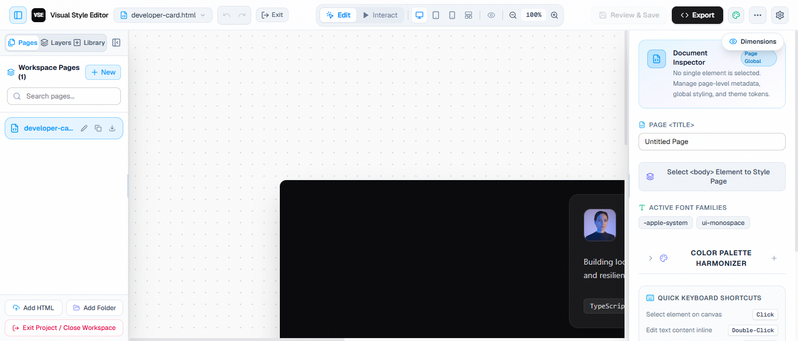
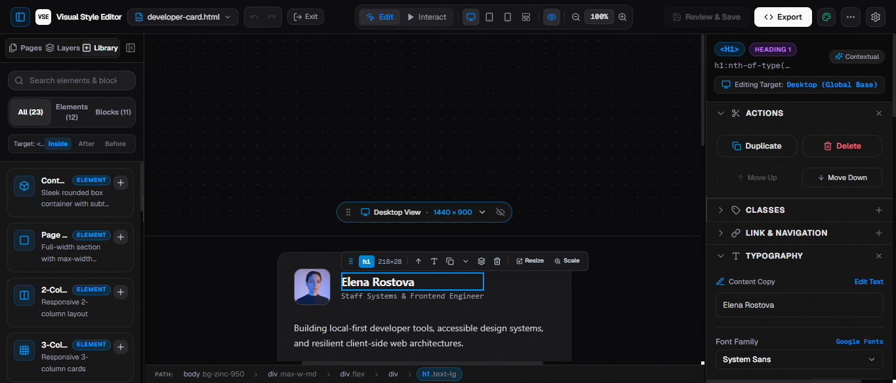
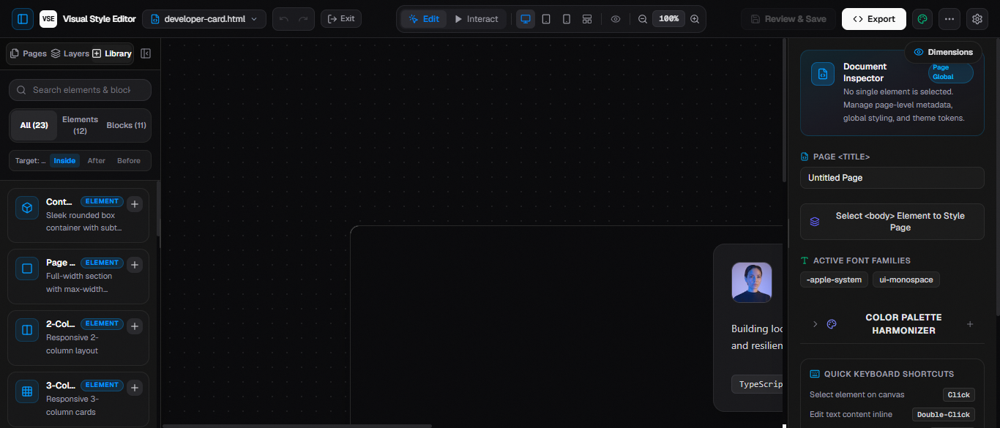
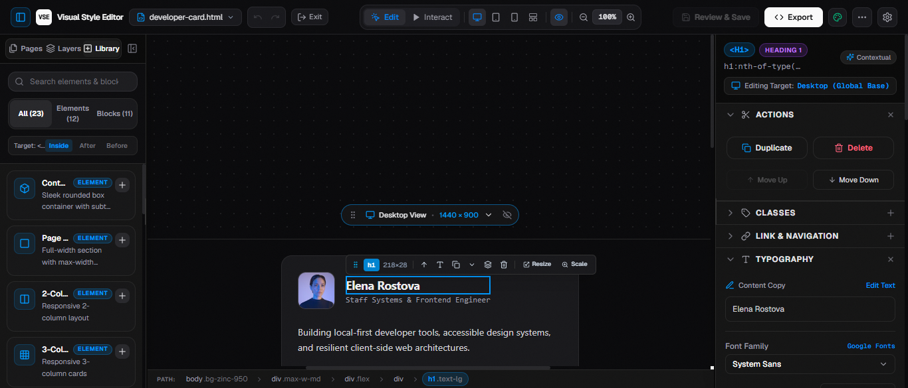

# Visual Style Editor (VSE)

<div align="center">


**The 100% In-Browser, Zero-Backend Visual HTML & Tailwind CSS Studio**  
*Drop any HTML file, click elements on a live canvas, visually tune styles, and export byte-perfect code.*

[](https://astro.build)
[](https://react.dev)
[](https://tailwindcss.com)
[](https://www.typescriptlang.org)
[-4ade80?style=flat-square&logo=vitest&logoColor=white)](test/)
[]()
[](LICENSE)

[Live App / Editor](http://localhost:4321/editor) • [Documentation](docs/) • [Architecture Overview](docs/PROJECT_OVERVIEW.md) • [Design System](DESIGN.md)

</div>

---

## Overview

**Visual Style Editor** is a local-first visual development studio designed for modern frontend developers, vibe coders, designers, and marketers. It bridges the gap between AI code generation and visual design refinement without prompt iteration latency or vendor lock-in.

### Why Visual Style Editor?

1. **Eliminate Prompt Fatigue**: Stop prompting AI models 5 times just to shift a button 4px or adjust typography. Drag sliders and click color swatches in real time.
2. **Surgical AST Preservation**: Traditional visual builders rewrite your entire HTML file, destroying comments, formatting, and script tags (GSAP, Swiper, custom analytics). VSE uses character-level byte-offset splicing (`parse5`) to ensure **only the exact characters changed are touched** — comments, indentations, and external scripts remain 100% byte-identical.
3. **100% In-Browser & Private**: Zero cloud backend, zero login, zero tracking. Your code never leaves your computer.
4. **Tailwind Native + Vanilla CSS**: Automatically detects Tailwind v3 CDN, Tailwind v4 Browser runtime, or Vanilla CSS, mapping styles directly to utility classes with clean inline CSS fallback.

---

## Key Features

### 🎨 Visual Studio Experience
* **Deep Dark Studio Theme**: Sleek, high-contrast dark environment by default with zero flash of unstyled content (Zero-FOUC).
* **Interactive Color & Gradient Maker**:
  * Seamless switcher between solid colors and gradients (`linear-gradient` & `radial-gradient`).
  * 0°–360° rotation angle controls and reverse stops.
  * Draggable multi-stop gradient track with custom color stops.
  * 12 curated designer presets (*Hyper Violet*, *Sunset Flare*, *Cosmic Blue*, etc.).
  * Automatic text gradient clipping (`-webkit-background-clip: text`) for headlines and typography.
* **Unified Component Library**:
  * Unified insertion panel merging 12 Element Primitives (`div`, `button`, `heading`, `input`, etc.) and 11 Production Section Blocks (`SaaS Pricing`, `Hero Section`, `Testimonial Grid`, `Newsletter`, etc.).
  * Real-time search and filter tabs (`All`, `Elements`, `Blocks`).
  * Relative placement selector (`Inside`, `After`, `Before`) with both drag-and-drop and one-click insertion.

### 📐 Canvas & Navigation
* **Figma-Style Canvas Pan & Zoom**:
  * Middle mouse button (`Wheel Hold`) + drag or `Space` + drag for fluid 60fps canvas panning.
  * Cursor-anchored zoom on `Ctrl + Wheel` zooming directly toward the mouse cursor.
  * Event shield overlay prevents the preview iframe from swallowing mouse movement during high-speed navigation.
* **Responsive Viewport Controls**:
  * Instant toggling between **Desktop** (1920×1080), **Tablet** (768×1024), **Mobile** (375×812), or **Custom Dimensions** (e.g. 1920×5000 with natural top-to-bottom scrolling).
  * Isolated media query previewing (`@media (max-width: 768px)` and `@media (max-width: 640px)`).

### ⚡ Non-Destructive Engine
* **Character-Offset AST Splicer**: Parses HTML ASTs with exact byte locations. Edits are applied in descending offset order so earlier offsets remain valid.
* **Multi-Level Undo/Redo**: Full state machine history (`Ctrl + Z` / `Ctrl + Y`) for styling, element repositioning, structural insertions, and removals.
* **Native File System Access**: Save directly back to your local file on disk via the browser File System Access API, or export/download clean HTML bundles.

---

## Screenshots

<div align="center">

| Dark Studio & Live Preview | Color & Gradient Maker |
|:---:|:---:|
|  |  |

| Unified Component Library | Property Inspector & Typography |
|:---:|:---:|
|  |  |

</div>

---

## Tech Stack

| Layer | Technology | Purpose |
|---|---|---|
| **Framework** | [Astro 5.x](https://astro.build) | Ultra-fast static site shell with hybrid React islands |
| **Studio UI** | [React 19](https://react.dev) | Interactive component tree, canvas, and property panels |
| **Styling** | [Tailwind CSS v4](https://tailwindcss.com) + Vanilla CSS | Modern responsive utility classes and bespoke dark theme tokens |
| **AST Parser** | [parse5](https://github.com/inikulin/parse5) | Character-accurate HTML serialization and offset mapping |
| **State Management**| [Zustand](https://github.com/pmndrs/zustand) | Decoupled stores for selection, change sets, undo/redo, and preferences |
| **Icons & UI** | [Lucide React](https://lucide.dev) | Clean, scalable interface iconography |
| **Test Suite** | [Vitest](https://vitest.dev) + Testing Library | 673 automated unit, integration, and AST regression tests |

---

## Quick Start

### Prerequisites
* [Node.js](https://nodejs.org/) (version 18.0.0 or higher recommended)
* `npm` or `pnpm`

### Installation

```bash
# Clone repository
git clone https://github.com/Amoga-Media/visual-style-editor.git
cd visual-style-editor

# Install dependencies
npm install
```

### Running Locally

```bash
# Start Astro development server
npm run dev
```

Open [http://localhost:4321/editor](http://localhost:4321/editor) in your browser. Drag and drop any `.html` file onto the drop zone or choose one of the built-in starter templates!

### Running Tests

```bash
# Run complete test suite (99 test files, 673 tests)
npm test

# Run tests in watch mode
npm run test:watch
```

### Production Build

```bash
# Build static site bundle
npm run build

# Preview production build locally
npm run preview
```

---

## Project Structure

```text
visual-style-editor/
├── docs/                             # Comprehensive project documentation & audits
│   ├── PROJECT_OVERVIEW.md           # Full system architecture & data flows
│   ├── BUGS_REPORT.md                # Exhaustive codebase audit & bug catalog
│   ├── DESIGN.md                     # Design tokens & aesthetic specifications
│   ├── UI_UX_IMPROVEMENT_PLAN.md     # Product design & UX enhancement plans
│   ├── HTML_TEST_FILES_ANALYSIS.md   # Test suite file analysis & compatibility matrix
│   ├── BUGS-AND-CHANGES.md           # Changelog & historical resolutions
│   ├── SKILLS_DIRECTORY.md           # Inventory of agent capabilities
│   └── v2-launch/                    # V2 launch roadmap & implementation guides
├── public/                           # Static assets, mockups, and starter templates
│   ├── images/                       # Centralized image assets
│   │   ├── editor-snapshots/         # Website & feature snapshot images
│   │   └── screenshots/              # Studio UI captures & audit verification
│   └── templates/                    # 11 starter templates (SaaS, Agency, Docs, etc.)
├── src/                              # Application source code
│   ├── components/
│   │   ├── editor/                   # Editor studio, canvas, overlay & property panels
│   │   ├── marketing/                # Landing page & marketing site components
│   │   └── ui/                       # Reusable UI primitives
│   ├── layouts/                      # Astro page layouts & Zero-FOUC theme scripts
│   ├── lib/
│   │   ├── ast/                      # parse5 AST location mapping & byte-offset splicer
│   │   ├── dom/                      # Live DOM reconciliation & responsive engines
│   │   ├── fs/                       # Native File System Access & export helpers
│   │   └── tailwind/                 # Tailwind v3/v4 classifier & forward-mapper
│   ├── pages/                        # Astro routes (/editor, /, /features, /templates)
│   ├── store/                        # Zustand stores (selection, undo, change-set, settings)
│   └── styles/                       # Global stylesheet & design tokens
├── test/                             # Automated test suite (Vitest + Testing Library)
├── files for testing/                # Diverse real-world HTML test files
├── Full Website Tests/               # Complete multi-page websites for regression testing
├── DESIGN.md                         # Root design system token specification
├── astro.config.mjs                  # Astro configuration
├── package.json                      # Dependencies and npm scripts
├── tsconfig.json                     # TypeScript configuration
└── vitest.config.ts                  # Vitest runner configuration
```

---

## Documentation Index

Explore detailed documentation inside the [`docs/`](docs/) directory:

* 📘 [**Project Overview & Architecture**](docs/PROJECT_OVERVIEW.md) — Architectural principles, state stores, and live DOM-to-AST synchronization.
* 🛡️ [**Codebase Audit & Bug Report**](docs/BUGS_REPORT.md) — 12-point audit, critical fixes, and test evidence.
* 🎨 [**Design System Specification**](docs/DESIGN.md) — Framer-inspired design philosophy, GT Walsheim typography, and surface palettes.
* 📱 [**HTML Compatibility Analysis**](docs/HTML_TEST_FILES_ANALYSIS.md) — Deep dive into Tailwind CDN, GSAP, and vanilla CSS test suites.
* 🚀 [**V2 Launch Roadmap**](docs/v2-launch/follow-guide.md) — Sequence guides, feature milestones, and prompt logs.

---

## License

This project is licensed under the [MIT License](LICENSE).
