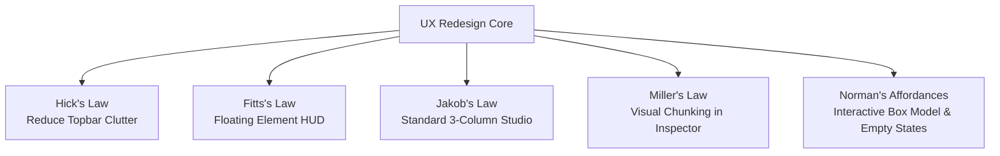
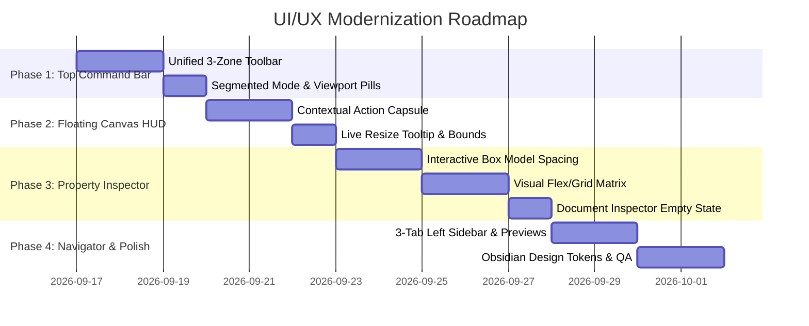

# Visual Style Editor — Comprehensive UI/UX Overhaul & Craft Architecture
**Author:** AI Design Director (Impeccable & Premium Frontend UI Standards)  
**Target:** Visual Style Editor (`visual-style-editor`)  
**Design System Mode:** `Operate` (High-Velocity Visual Web Development Tool)  
**Standard Compliance:** Laws of UX, Web Interface Guidelines, High-Craft Editorial & Modern Engineering Aesthetics

---

## 1. Executive Summary & Creative Direction

### The Problem
Feedback from first-time users and designers revealed that while the core engineering (AST splicing, multi-page workspace, live live-style engine, scroll unblock bridge) is technically robust, the **User Interface (UI) and User Experience (UX)** suffer from high cognitive load, fragmented tool placement, visual clutter, and non-standard mental models.

### The Creative POV: "Precision Dark Engineering Studio"
Visual Style Editor should feel like a state-of-the-art hybrid between **Figma's precision vector canvas**, **Webflow's structured style inspector**, and **VS Code's reliable speed**.

- **Aesthetic Persona:** Minimalist Charcoal & Obsidian (`#09090B` / `#121215`), hairline borders (`border-white/[0.08]`), electric cobalt focus accents (`#0084FF` / `#38BDF8`), translucent glassmorphism surfaces (`backdrop-blur-xl`), and crisp typographic hierarchy with Google Inter & Outfit.
- **Operating Principle:** **Progressive Disclosure**. Complex settings remain one click away without overwhelming the default canvas view.

---

## 2. Laws of Design & Core UX Principles Applied



### 1. Hick’s Law (Decision Time & Cognitive Load)
- **Current Defect:** The top toolbar houses 18+ disparate buttons with identical visual weights (Undo, Redo, Viewports, Zoom, Mode, Theme, Version History, Project Config, Shortcuts, HTML/JSX, Export Studio, Review & Save). Users experience choice paralysis.
- **Solution:** Consolidate into **3 distinct command clusters**:
  1. *Left:* Document/Project Navigator (`<Logo>`, Page Selector, Dirty Indicator).
  2. *Center:* Stage Command Capsule (Edit vs. Interact toggle, Viewport Presets, Zoom Popover).
  3. *Right:* Primary Actions (Status, Review Changes pill, High-contrast "Export Studio" CTA).

### 2. Fitts’s Law (Target Accessibility & Travel Distance)
- **Current Defect:** When an element is selected, manipulating it (moving, duplicating, editing text, deleting, or wrapping) requires long mouse travel to tiny buttons scattered in the sidebar or right inspector.
- **Solution:** Introduce the **Floating Contextual HUD (Action Capsule)** attached directly above/below the selected element on the canvas:
  - `<tag>` name & dimensions badge.
  - Parent element selector ($\uparrow$).
  - Quick Inline Text Edit (`T`).
  - Duplicate (`⌘D`) & Delete (`⌫`).
  - Move Up/Down ($\uparrow$/$\downarrow$).
  - Wrap in Div (`⊞`).

### 3. Jakob’s Law (Mental Models & Industry Conventions)
- **Current Defect:** Unconventional tab abbreviations (`Prims`, `Blocks`) and overlapping page vs file management confuse users coming from Figma, Webflow, and Chrome DevTools.
- **Solution:** Follow standard 3-pane visual builder layout:
  - **Left Sidebar:** Structure & Assets (`Pages`, `Layers Tree`, `Component Blocks`).
  - **Center Area:** Responsive Interactive Canvas with floating breadcrumbs and device rulers.
  - **Right Sidebar:** Visual Inspector (`Design`, `Tailwind Classes`, `Custom CSS`).

### 4. Miller’s Law (Working Memory Chunking)
- **Current Defect:** The Right Property Panel renders dozens of flat numeric inputs in an endless scrolling list.
- **Solution:** Group controls into visual, collapsible **Property Cards** with immediate graphic tokens:
  - *Layout & Position:* Visual 3×3 Flex/Grid Alignment Matrix.
  - *Dimensions & Spacing:* Interactive Box-Model Visualizer (Margin & Padding concentric rectangles).
  - *Typography:* Font family badge with live preview, weight selector, visual alignment pills.
  - *Visual Styles:* Color swatches, border-radius corner handles, shadow elevation chips.

### 5. Norman’s Principles of Feedback & Affordances
- **Current Defect:** When no element is selected, the right panel shows a dead blank space. Resizing has no real-time dimension readout.
- **Solution:**
  - **Smart Empty State (Document Inspector):** When nothing is selected, the Right Panel displays the *Global Document Inspector* (Page Title, Meta Description, Body Background Color, Fonts in Use, Project Color Palette, Global Tailwind Config).
  - **Live Resize Tooltip:** Floating pill displaying `1240 × 680 px (100%)` during drag.
  - **Canvas Margin/Padding Hover Bands:** Subtle translucent overlay showing padding (cyan) and margin (orange) on hover.

---

## 3. Detailed Component-by-Component Redesign

```
+-------------------------------------------------------------------------------------------------------+
|  [Logo] [Page: index.html ▾] (2 dirty)  |  [ (Edit | Interact) ] [Desktop ▾] [100% ▾]  |  [Save] [Export Studio] |
+-----------------------+-------------------------------------------------------+-----------------------+
|  STRUCTURE & ASSETS   |                   CANVAS STAGE                        |   DESIGN INSPECTOR    |
|  [Pages] [Layers] [+] |                                                       |  <section.hero>       |
|  -------------------  |   +-----------------------------------------------+   |  [Design] [Code]      |
|  ▾ pages/             |   | Floating HUD: <h1.title> | [T] [⌘D] [⌫] [▾]   |   |  -------------------  |
|    • index.html       |   | +-------------------------------------------+ |   |  ▾ LAYOUT (Flex)      |
|    • about.html       |   | |  [Selected: Hero Title                   ] | |   |    [ ⬚ ⬚ ⬚ ] Matrix   |
|    • menu.html        |   | +-------------------------------------------+ |   |  ▾ SPACING (Box Model)|
|  ▾ Components/        |   +-----------------------------------------------+   |    [ Margin / Pad ]   |
|    • Hero Header      |                                                       |  ▾ TYPOGRAPHY         |
|    • Pricing Card     |                                                       |    Inter, 48px, Bold  |
+-----------------------+-------------------------------------------------------+-----------------------+
| [?] Shortcuts | (Dark) | Path: body > section.hero > div.container > h1.title   | Zoom: 100% | 1920×1080 |
+-------------------------------------------------------------------------------------------------------+
```

---

### 3.1 The Top Unified Command Bar (`Toolbar.tsx`)

#### Flaws in Current Design:
1. Low visual hierarchy — "HTML / JSX copy", "Export Studio", "Review & Save" and "Snap to default" all compete for attention.
2. The page dropdown is hidden behind a small plain text label.
3. Undo/Redo icons are disconnected from the canvas context.

#### Redesigned Layout & Structure:

```tsx
// Three-zone Command Bar Architecture
<header className="h-14 bg-[#0D0D10]/95 backdrop-blur-md border-b border-white/[0.08] px-4 flex items-center justify-between z-30">
  {/* ZONE 1: Project & Workspace */}
  <div className="flex items-center gap-3">
    <div className="flex items-center gap-2 pr-3 border-r border-white/[0.08]">
      <LogoIcon className="w-6 h-6 text-[#0084FF]" />
      <span className="font-bold text-sm text-white tracking-tight">Visual Studio</span>
    </div>
    <WorkspacePageDropdown activePage={activePage} dirtyCount={dirtyCount} />
    <UndoRedoButtonCluster undoCount={past.length} redoCount={future.length} />
  </div>

  {/* ZONE 2: Canvas Controls & Modes */}
  <div className="flex items-center gap-2 bg-[#16161A] p-1 rounded-xl border border-white/[0.06]">
    <SegmentedControl
      options={[
        { id: "edit", label: "Edit", icon: Edit3 },
        { id: "interact", label: "Interact", icon: Play },
      ]}
      active={canvasMode}
      onChange={setCanvasMode}
    />
    <div className="h-4 w-px bg-white/10 mx-1" />
    <ViewportSegmentedSwitcher viewport={viewport} onChange={setViewport} />
    <ZoomDropdown zoom={zoom} onChange={setZoom} />
  </div>

  {/* ZONE 3: Project Actions */}
  <div className="flex items-center gap-2.5">
    <ProjectConfigButton hasConfig={hasConfig} onClick={openConfigModal} />
    <ReviewChangesButton editCount={edits.length} onClick={openReviewModal} />
    <button 
      onClick={openExportStudio}
      className="h-9 px-4 rounded-lg bg-[#0084FF] hover:bg-[#0074E0] text-white text-xs font-semibold shadow-lg shadow-[#0084FF]/20 transition-all flex items-center gap-2"
    >
      <Sparkles className="w-3.5 h-3.5" />
      <span>Export Studio</span>
    </button>
  </div>
</header>
```

---

### 3.2 The Canvas & Floating Contextual HUD (`SelectionOverlay.tsx`)

#### Flaws in Current Design:
1. Once an element is clicked, the user has no direct on-canvas feedback on what actions are available.
2. Resizing an element offers no visual dimension indicator.
3. Sibling navigation (moving up/down, selecting parent container) requires hunting in the sidebar layers tree.

#### Redesigned Selection Overlay & Action HUD:

1. **Floating Action HUD (Capsule):**
   - Renders 8px above or below the selection bounding box with automatic boundary detection (stays inside canvas).
   - Contains:
     - **Breadcrumb Tag Badge**: `<button.btn-primary>` with class summary.
     - **Parent Navigation Button ($\uparrow$)**: Quickly select the parent container (`div.flex`).
     - **Inline Text Edit (`T`)**: Activates direct WYSIWYG text typing.
     - **Duplicate (`⌘D`)**: Instant cloning with ID collision protection.
     - **Move Buttons ($\uparrow \downarrow$)**: Reorders element within its parent flex/grid.
     - **Wrap in Container (`⊞`)**: Wraps selected item in a new `<div>`.
     - **Delete (`⌫`)**: Triggers atomic deletion with undo.

2. **Interactive Box-Model Overlay (Figma/Chrome DevTools Style):**
   - On hover over margin/padding inputs in the inspector, the canvas displays colored translucent tint boxes on the element:
     - **Margin:** Soft amber (`rgba(245, 158, 11, 0.15)` with dashed border).
     - **Padding:** Soft cyan (`rgba(6, 182, 212, 0.2)` with dotted border).

---

### 3.3 The Left Sidebar (`Pages`, `Layers`, `Blocks`)

#### Flaws in Current Design:
1. `Prims` and `Blocks` tabs are confusingly separated and lack search or visual previews.
2. Tree items lack clear tag icons and active selection states.

#### Redesigned Left Navigator:

1. **Clean 3-Tab Architecture:**
   - **`Pages` Tab**: Multi-page list with search, New Page button, duplicate, delete, and dirty state badges.
   - **`Layers` Tab**: High-contrast DOM hierarchy tree with collapsible nodes, color-coded tag chips (`<header>` purple, `<section>` blue, `<p>` green, `` orange), eye icon for toggling visibility, and drag-to-reorder handles.
   - **`Components & Blocks` Tab**: Searchable library with categorized accordion groups:
     - *Typography:* Hero Headings, Paragraphs, Blockquotes, Badges.
     - *Layout:* Container, Flex Row, 2-Column Grid, 3-Column Grid, Card Grid.
     - *UI Elements:* Buttons, Input Fields, Badges, Avatars, Modals.
     - *Pre-built Sections:* Navbars, Hero Sections, Pricing Tables, Feature Grids, Footers.
     - *Visual Previews:* Hovering any component renders a floating miniature snapshot of the block.

---

### 3.4 The Right Property Inspector (`PropertyPanel.tsx`)

#### Flaws in Current Design:
1. Endless flat scroll without strong visual anchors.
2. Plain number inputs for margin and padding instead of an intuitive box model.
3. Flexbox/Grid controls are text dropdowns rather than visual directional matrices.
4. When nothing is selected, the panel is a dead empty state.

#### Redesigned Property Groups:

#### A. Document Inspector (Empty State when nothing is selected)
When the user clicks the canvas background:
- **Page Information**: File Name, Title `<title>`, Meta Description.
- **Global Theme & Colors**: Palette chips extracted from the page/Tailwind config (click any swatch to copy class or apply globally).
- **Font Stacks in Use**: Google Fonts and font family definitions with live preview pills.
- **Quick Insert**: Button to drag in a new Section or Container.

#### B. Visual Box-Model Visualizer (Spacing Group)
Replaces 8 isolated text inputs with an interactive concentric box diagram:
```
+-----------------------------------------------------+
|                      MARGIN                         |
|                      [ 24 ]                         |
|     +-----------------------------------------+     |
|     |                PADDING                  |     |
|     |                [ 16 ]                   |     |
| [0] | [12]      [ ELEMENT CONTENT ]      [12] | [0] |
|     |                [ 16 ]                   |     |
|     +-----------------------------------------+     |
|                      [ 24 ]                         |
+-----------------------------------------------------+
```
*Clicking any number activates a micro-stepper (`+` / `-` / Drag scrub / Direct type).*

#### C. Visual Flex & Grid Alignment Matrix (Layout Group)
Replaces text dropdowns with intuitive 3×3 icon matrices:
- **Direction:** `Row →`, `Row ←`, `Column ↓`, `Column ↑`.
- **Justify & Align:** 3×3 interactive grid of dots (Top-Left, Center, Space-Between, Bottom-Right).
- **Gap:** Visual slider + direct pixel/rem input with preset chips (`8px`, `16px`, `24px`, `32px`).

#### D. Color & Typography Groups
- **Typography:**
  - Font Family dropdown featuring Google Fonts with rendered font previews.
  - Size slider with fluid `clamp()` toggle.
  - Visual Weight Pills (`Light`, `Regular`, `Medium`, `Semibold`, `Bold`, `Black`).
  - Text Alignment segmented buttons (`Left`, `Center`, `Right`, `Justify`).
- **Colors:**
  - Project Swatches bar (recent & brand palette tokens) for 1-click styling.
  - Hex / RGB / HSL input with live opacity slider.
  - Quick Tailwind class generator (`bg-slate-900`, `text-blue-500`).

---

### 3.5 Export Studio & Modals Overhaul

1. **Export Studio (`ExportStudioModal.tsx`)**:
   - Multi-Framework Tabs: **HTML (Vanilla)**, **React (JSX + Tailwind)**, **Next.js (App Router)**, **Astro Component**, **Pure CSS Stylesheet**.
   - Integrated Split View: Clean formatted syntax-highlighted code editor on the left, live responsive preview on the right.
   - Primary Action Bar: Direct **Save File to Disk** (single-click AST update), **Download ZIP Package** (all pages + assets), **Copy Code**.
2. **Project Config Modal (`ProjectConfigModal.tsx`)**:
   - Drag-and-drop dropzone for `tailwind.config.js` and `style.css`.
   - Live Token Summary: Visual chips showing parsed Brand Colors (`brand-gold: #D4AF37`), Custom Fonts (`Poppins`, `Inter`), and custom utility classes.

---

## 4. Design Token Specifications

### Color Palette (Obsidian Studio Theme)
| Token | Value | Usage |
| :--- | :--- | :--- |
| `--vse-bg-canvas` | `#09090B` | Deep background behind preview iframe |
| `--vse-bg-panel` | `#111114` | Sidebar and inspector surface |
| `--vse-bg-panel-elevated` | `#18181C` | Dropdowns, tooltips, floating HUDs |
| `--vse-border-subtle` | `rgba(255, 255, 255, 0.07)` | Standard panel and card borders |
| `--vse-border-strong` | `rgba(255, 255, 255, 0.14)` | Hover and active input borders |
| `--vse-accent-primary` | `#0084FF` | Primary CTA, active selections, focus rings |
| `--vse-accent-cyan` | `#06B6D4` | Padding highlights, helper tags |
| `--vse-accent-amber` | `#F59E0B` | Margin highlights, warning badges |
| `--vse-accent-emerald` | `#10B981` | Success states, saved notifications |

### Typography Stack
- **UI Interface Font:** `Inter`, `-apple-system`, `BlinkMacSystemFont`, `sans-serif` (Crisp, highly legible at 11px-13px).
- **Display & Section Titles:** `Outfit`, `Inter`, `sans-serif` (Modern, geometric character).
- **Code & Structural Paths:** `JetBrains Mono`, `Fira Code`, `monospace` (Fixed-width for paths and tags).

### Micro-Interactions & Transitions
- **Button Hover:** `transform: translateY(-1px)`, `transition: all 150ms cubic-bezier(0.16, 1, 0.3, 1)`
- **Modal Backdrop:** `backdrop-filter: blur(12px)`, `bg-black/60`
- **Selection Box Animation:** Bounding box ring fades in smoothly with `scale(1) opacity(1)` in `120ms`.

---

## 5. Phased Implementation Roadmap



### Phase 1: Top Command Bar Consolidation (`Toolbar.tsx`)
- Implement the 3-zone architecture.
- Replace text dropdowns with sleek segmented pills for Edit/Interact and Viewport switching.
- Elevate "Export Studio" to a high-contrast primary CTA.

### Phase 2: Canvas Selection HUD (`SelectionOverlay.tsx`)
- Build the floating Contextual Action Capsule (Breadcrumb, Inline Text Edit, Duplicate, Delete, Parent Jump, Wrap).
- Add live real-time `W × H` dimension badge during corner resizing.

### Phase 3: Inspector Overhaul (`PropertyPanel.tsx`)
- Build the interactive concentric Box Model (Margin/Padding visualizer).
- Build the 3×3 visual alignment matrix for Flexbox and CSS Grid.
- Implement the Document Inspector empty state when nothing is selected.

### Phase 4: Navigator, Assets & Visual Polish
- Streamline Left Sidebar into `Pages`, `Layers`, and `Components`.
- Add miniature hover previews for pre-built layout blocks.
- Polish obsidian dark theme design tokens, borders, and micro-transitions.
